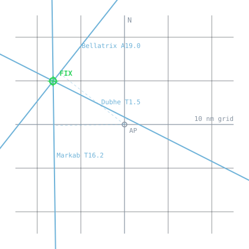
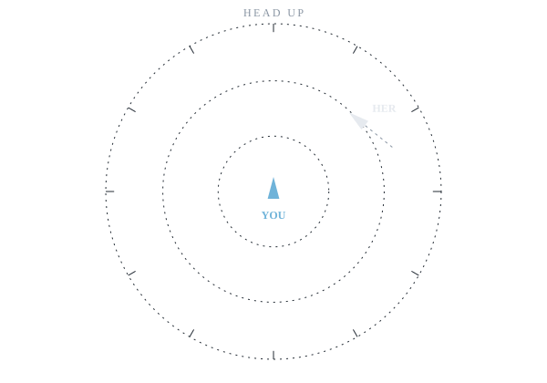
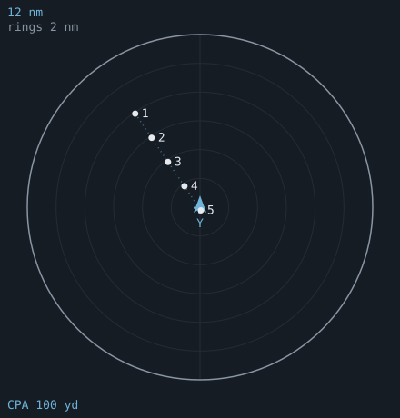
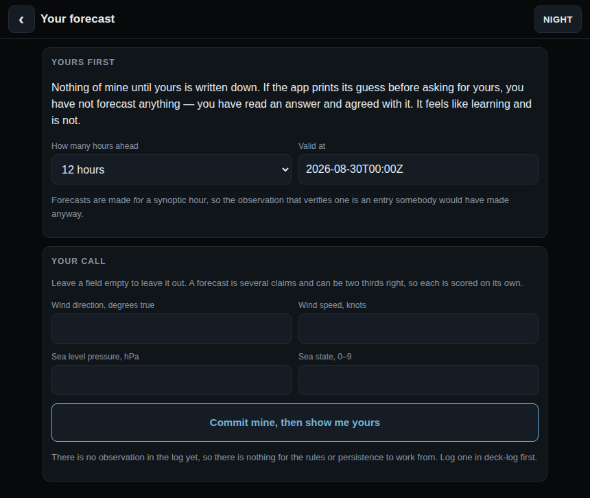
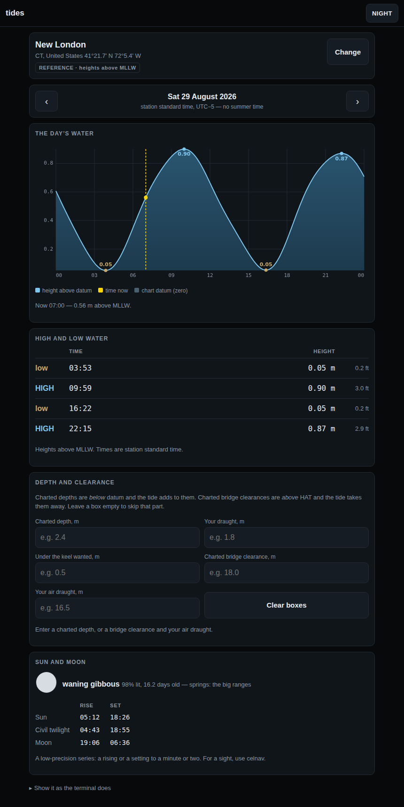
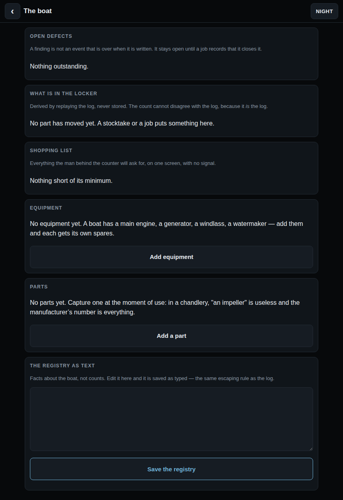
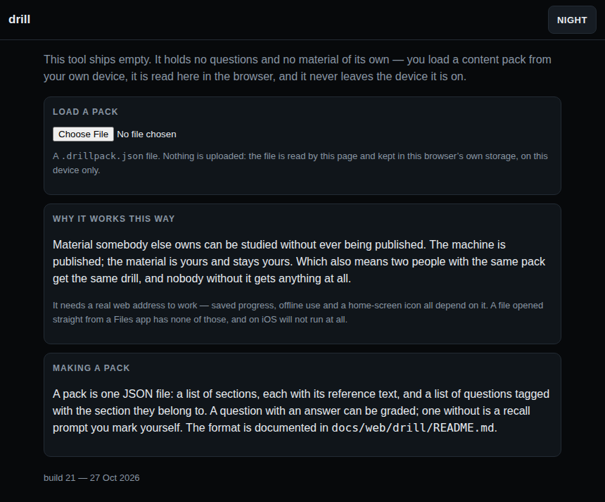

# Bash Navigation Software

Six marine tools you open in a browser and use at sea with no signal.
Celestial navigation, the rules of the road, tides, the boat's log, the
weather, and a study machine that ships empty.

They install to a home screen, they cache themselves, and they keep working
with the aircraft mode on. There is no account, no server, and nothing leaves
the device.

| | |
|---|---|
| **[celnav](https://larrys614.github.io/bashnav/web/celnav/)** | Celestial navigation. An altitude from a photograph of the sun or moon, and thirty-three lessons in nine modules that teach the subject from first principles. |
| **[colregs](https://larrys614.github.io/bashnav/web/colregs/)** | The rules of the road. Lights and shapes drawn from any angle, 28 encounter scenarios, sound signals, contact management, and lessons on the rules themselves. |
| **[tides](https://larrys614.github.io/bashnav/web/tides/)** | Harmonic prediction for 8,334 stations worldwide: the day's table, the curve, the moon and sun, and the question a tide table exists to answer — is there enough water. |
| **[deck-log](https://larrys614.github.io/bashnav/web/deck-log/)** | The boat's records — deck, engine, provisions — kept append-only in UTC, with the spares worked out by replaying the log rather than stored. |
| **[weather](https://larrys614.github.io/bashnav/web/weather/)** | Read your own barometer. It will not show you its forecast until yours is written down, then scores both against what happened. Ten lessons on the physics underneath. |
| **[drill](https://larrys614.github.io/bashnav/web/drill/)** | A study machine with no material in it. You load a content pack from your own device; it is read in the browser and never leaves it. |

**[Open the launcher](https://larrys614.github.io/bashnav/web/)** to reach all
six from one screen.

---

## How to use them

**On a phone or an iPad.** Open a link above, then add it to the home screen —
in Safari, Share → *Add to Home Screen*. It opens like an app, full screen,
with no browser bar. The first time you open it with a signal it caches
itself; after that it runs with no network at all. Each tool says on its own
home screen whether it is cached yet.

**On a laptop.** The same links work in any modern browser. There is
no app to install on any platform — a browser app added to the home screen is
the whole of it.

**Offline is the point, not a feature.** These are for a boat with no signal.
Each tool carries its own service worker and its own cache, so losing one does
not take the others with it, and each one tells you its state rather than
leaving you to guess.

**Night vision.** Every tool has a NIGHT button. It is not a dark theme — it
drops the whole interface to a single red, because anything else costs you
twenty minutes of adaptation on deck.

---

## Examples

### A fix from three star sights

`celnav` reduces each sight, then crosses the lines of position and gives you
the fix with the residual at each line — so you can see which sight is pulling
and decide whether to believe it.

```
  FIX   35 09.9'N   040 20.0'W
  Offset from DR: 9.9 nm N, 16.4 nm W   (19.2 nm on 301 T)

  LOP residuals at the fix (nm):
    a Dubhe      Zn 027 T   intercept from DR    1.5   residual  +0.01
    b Bellatrix  Zn 128 T   intercept from DR  -19.0   residual  +0.01
    c Markab     Zn 269 T   intercept from DR   16.2   residual  +0.01
```



### An encounter, and what you do about it

`colregs` draws her as you would see her, asks what you do, and then tells you
which rule decided it — and only then gives you the bearing as a number, so the
number cannot give the answer away.

```
  You are a 12 m yacht under sail, crossing a traffic separation scheme.
  You see a container ship following the lane, broad on your starboard bow,
  heading as drawn.

  Right - the answer is B.   Rule 10.
  Rule 10(j): a vessel under 20 metres or a sailing vessel shall not impede
  the safe passage of a power-driven vessel following a traffic lane. And
  Rule 10(c) says cross on a heading as nearly as practicable at right
  angles to the flow - heading, not ground track, because a beam-on aspect
  is what makes you visible and predictable.
  (she bore 051 relative -- Green 51.)
```



### Does she pass ahead of you, or astern?

The contact-management section is the one a tracking party would recognise:
five marks three minutes apart, and the three questions the plot exists to
answer. The plot carries the standard radar range scales, because the CPA is
only readable once you have changed down.

```
      time     bearing  relative                    range
      0000     206      Red 38                     11,900
      0003     204      Red 40                     10,000
      0006     201      Red 43                      8,200
      0009     195      Red 49                      6,400
      0012     186      Red 58                      4,700

  Q1  bearing drawing left   - right
      She is on your port bow and the bearing is drawing AWAY from your bow,
      so she cannot cross ahead of you. A contact drawing away from your bow
      passes astern - the relative track is a straight line and the bearing
      can never come back.
  Q2  she passes astern   - right
  Q3  CPA 2,500 yards at 18 minutes   - you said C

  "Master 2, bearing 186, Red 58, drawing left, range 4,700,
   CPA 2,500 at 18 minutes."
```



That plot is a different contact from the report above — five marks closing to a
hundred yards astern, on the 12 mile scale, which is the smallest scale that
still holds her. Changing down is the whole point: on a 24 mile picture those
five marks sit on top of one another and the CPA cannot be read at all.

How a relative bearing is spoken is a setting — Red/Green, Port/Starboard,
`340 relative`, in words, or the true bearing alone. Which one is right
depends entirely on who is listening.

### Forecast before you look

`weather` reasons over your own log whenever you ask it to. Four observations
from one night — two positions and two barometer readings — and it finds eight
things in them, each with the rule it came from. Four of the eight:

```
  WHAT THE LOG SAYS
  ----------------------------------------------------------------------
  Pressure 1010.1, -6.3 hPa in 6.0 hours.
  That is a serious fall. Expect a deepening system and a rising wind.
     a rate matters more than a level: 1000 hPa steady is a quiet day,
     1015 falling fast is not.

  Wind has BACKED 40 degrees, 210 to 170.
     northern hemisphere: backing with a falling glass puts the centre
     to your north and closing. This is the one to take seriously.

  Back to the wind: the low is roughly 260 from you.
     Buys Ballot. Stand with your back to the wind: in the northern
     hemisphere the low is on your left, in the southern, on your right.

  The cloud has run the whole warm-front sequence: high, then
  middle, and now low stratus. The front is on you or past.
     cirrus -> cirrostratus -> altostratus -> nimbostratus and rain
  ----------------------------------------------------------------------
  This reasons only from what you logged. It is not a forecast:
  no model, no chart, no GRIB. It is you, reading your own barometer.
```

What it will **not** do is tell you what happens next until you have said so
first. That is enforced rather than suggested, and the test suite asserts it on
every run: anticipation is the only thing being taught here, and reading an
answer and agreeing with it is not anticipation. Commit yours, and then both
are scored against what actually happened — including against simple
persistence, so you can see whether you beat doing nothing.



### A day's water, and what is under the keel

8,334 stations' harmonic constants are carried in the tool, so the prediction
is computed where you are standing rather than fetched. No network, no
subscription, and no summer time — station standard time, exactly like a
printed tide table.

```
  New London
  CT, United States   41.3614 -72.0900   heights above MLLW
  2026-08-29   Sat   times in the station's standard time
  ----------------------------------------------------------------------
         time     height
  low    03:53     0.05 m
  HIGH   09:59     0.90 m
  low    16:22     0.05 m
  HIGH   22:15     0.87 m
  ----------------------------------------------------------------------

  SUN AND MOON
  ----------------------------------------------------------------------
  Sun     rises 05:12   sets 18:26
  civil twilight begins 04:43   ends 18:55
  Moon    rises 19:06   sets 06:36
  waning gibbous  98% lit, 16.2 days old
```

The picture below is that same day in the browser build, and the heights and
the rise and set times in it are the ones printed above, to the minute. Two
implementations, one set of constants. It adds the curve, the depth helper —
charted depth plus the tide against your draught, or a bridge clearance minus
it — and the moon's phase, which is what tells you whether these ranges are
springs or neaps.



### How many impellers are aboard?

`deck-log` does not know. It works it out, every time you ask, by replaying
what the log says was counted, used and restocked. The locker was counted at
two impellers on 20 August; a job on the 28th changed one. So:

```
  SPARES ABOARD
  ----------------------------------------------------------------------
  raw water impeller       1  1 short of 2
    Jabsco 17937-0001   fits eng.main
    stowed: box 3, port locker
  primary fuel filter      2  min 2
    Racor 2010SM-10   fits eng.main
    stowed: box 3, port locker
  generator impeller       1  min 1
    Jabsco 22405-0001   fits gen
    stowed: box 4
  ----------------------------------------------------------------------

  SHOPPING LIST
  ----------------------------------------------------------------------
  raw water impeller       x1   have 1, want 2
    Jabsco 17937-0001
    fits: Yanmar 4JH4-TE  s/n E12345
    stow: box 3, port locker
```

Nothing anywhere stores the number 1. A stored count is the obvious design and
it is the one that goes wrong: it drifts from the log, and then you have two
numbers and no way to know which of them lied. The same replay produces the
shopping list — one impeller, with the part number the chandler will ask for —
and keeps the strainer finding of the 26th open, because a finding is not an
event that is over when it is written. It stays open until a job records that
it closed it.



### A study machine with nothing in it

`drill` is the one tool with no shell build, because what it does cannot be
done in a terminal: it reads a file you choose from your own device, keeps it
in that browser's own storage, and never sends it anywhere.

That is the whole design. **Material somebody else owns can be studied without
ever being published.** The machine is published; the material is yours and
stays yours — which also means two people with the same pack get the same
drill, and nobody without it gets anything at all. A pack is one JSON file:
sections with their reference text, and questions tagged with the section they
belong to. A question with an answer is graded; one without is a recall prompt
you mark yourself.



---

## The six tools

### celnav

**Camera sight** gets an altitude from a photograph of the sun or moon: you
mark the horizon and the limb, it corrects for index error, dip, refraction,
semi-diameter and parallax, and gives you Ho. A phone camera is not a sextant
and the tool says so — it is an estimate, and it tells you how big the
estimate's uncertainty is.

**Learn** is thirty-three lessons in nine modules, each ending in a question
that is marked:

    Before the sights         dead reckoning, three kinds of position, set and drift
    Foundations               what a sight measures, the GP, the circle, the fix
    Time and the almanac      UT, GHA and declination, Aries and SHA, LHA
    Sextant and corrections   taking a sight, index error and dip, refraction,
                              semi-diameter and parallax, the whole chain
    Reduction and the fix     the assumed position, Hc and Zn, the intercept,
                              plotting, crossing and running
    Latitude the direct way   the noon sight, Polaris
    The other bodies          the moon, the planets
    Choosing and checking     choosing your bodies, checking the compass by the sky
    The tables                what a reduction table is, Volumes 1 to 3, and when
                              the tables beat the calculator

Nine of those lessons carry a diagram — ten in all, since one has two. They are
the app's own drawings rather than pictures of a terminal: the browser draws
them from the same figures the shell lesson prints, so the two builds teach the
same lesson from the same numbers.

### colregs

Lights and shapes for 22 vessel types, drawn from any bearing you choose, so
you learn the arcs rather than a memorised picture. 28 encounter scenarios
with the wind and the vessel kind both shown. Sound signals, drawn because a
page cannot make a noise. Fifteen lessons on the rules themselves, and seven
on contact management with two exercises — the tracking party, and Ekelund,
which gets a range out of a course change with bearings only.

Where this and the Convention differ, the Convention is right and this is
wrong. That is not a disclaimer, it is the rule the content is held to.

### tides

Harmonic prediction from constants measured at each station — 8,334 of them,
carried in the tool rather than fetched. The day's heights, the curve, the
moon and the sun, and the clearance under a bridge where there is one.

### deck-log

Append-only, in UTC. Nothing is ever rewritten: a correction is a new entry
that refers to the old one, which is how a log stands up afterwards. Spares
are not stored as a number — they are worked out by replaying what the log
says was used.

### weather

Your own barometer, reasoned over and shown working: the pressure tide,
backing and veering, Buys Ballot, fog, cloud base, the warm-front cloud
sequence, and swell as the earliest warning there is. Then you forecast, it
forecasts, and both are scored against what happened — including against
simple persistence, so you can see whether you actually beat doing nothing.

### drill

A study machine that ships with nothing in it. Sections, recall practice, and
a graded test that opens the next section when you pass. You load a content
pack from your own device; it is read by the page and kept in that browser's
own storage. **Material somebody else owns can be studied without ever being
published.** The machine is published; the material is yours and stays yours.

---

## The shell build

Every app above is generated from, and checked against, a POSIX `sh` and `awk`
implementation of the same thing. That is where the arithmetic lives and why
the two agree.

```sh
git clone https://github.com/larrys614/bashnav.git
cd bashnav
./bin/celnav doctor        # checks your awk, your clock and the data folder
```

One file per tool, no dependencies, no install step:

```sh
mkdir -p ~/bin
cp bin/celnav bin/colregs bin/tides bin/deck-log bin/weather bin/bashnav ~/bin/
chmod +x ~/bin/*
bashnav                    # a menu of the other five
bashnav tides              # or straight to one
```

Six scripts, one of which is the launcher:

| | |
|---|---|
| **[celnav](#celnav)** | sight reduction, the fix, the almanac, the teaching track |
| **[colregs](#colregs)** | lights and shapes, encounters, sound signals, contacts |
| **[tides](#tides)** | harmonic prediction, 8,334 stations |
| **[deck-log](#deck-log)** | the boat's records, append-only, in UTC |
| **[weather](#weather)** | your own barometer, scored against what happens |
| **[bashnav](#bashnav)** | the launcher — one menu reaching the other five |

Works on macOS, Linux and the BSDs. **For an iPad, use the browser apps** —
the shell build ran there under a-Shell and that route is being retired in
favour of the apps, which are better on a phone in every way that matters. If
you do run the shell build under a-Shell, note that iOS gives an app only its
own sandbox to write in: `~/Documents` is the one place a-Shell can create
files, and that is where each tool keeps its data folder.

### bashnav

Pure `sh`, no `awk` at all, so the launcher starts even when the thing that is
wrong is the awk. It is one home-screen icon reaching all five, and it passes
its arguments straight through, so `bashnav tides find london` goes where you
would expect.

```sh
  ===============================================================
   BASH NAVIGATION SOFTWARE 1.0
  ===============================================================

    1  celnav    Celestial navigation, sight reduction and the fix
    2  colregs   Rules of the road, lights, and collision avoidance
    3  tides     Tide prediction for 8,334 stations
    4  deck-log  The boat's records: deck, engine, provisions
    5  weather   Read your own barometer

    q  Quit

  >
```

---

## How it is verified

```sh
./tests/run-tests.sh                                        # whatever sh and awk you have
SHELLS="dash bash" AWKS="mawk gawk" ./tests/run-tests.sh    # the full matrix
```

**1,314 checks**, run against every shell and every awk on the machine —
including one-true-awk, because mawk, gawk and one-true-awk disagree about
things that matter and a run under one of them proves nothing about the
others.

The parts that stop the browser and the shell drifting apart are diffs, not
assertions that they agree:

- **21,264 comparisons** between the browser's colregs and the shell's, over
  every bearing, every vessel, and all five reporting styles.
- **4,099 comparisons** of the contact-management module, over forty generated
  contacts in every reporting style — every table row, every sentence, the
  spoken report and the marking.
- Every generated file is regenerated during the suite and compared with what
  is committed, so a change to the shell that has not reached the browser
  fails here rather than at sea.

**What the suite cannot check is whether any of it is true about the sea.** It
checks that the program works. Everything this project has got wrong about
seamanship was found by a person using the tools and reporting what they saw —
a lesson that had a sprayhood blocking the wrong view, a question whose answer
was not on the card it cited, a bearing rate that named the wrong direction on
one platform. None of those was a crash. `colregs review` exists for that: it
stops teaching and asks to be taught, putting 163 claims to a reader with the
Convention open.

---

## Safety

**These are training and cross-checking tools, not certified navigation
equipment.** Read [SAFETY.md](SAFETY.md) before you rely on any of them at sea.
The COLREGs as published by the IMO are what govern; where `colregs` and the
Convention differ, the Convention is right and this program is wrong.

---

## How it is built

If you want to change something, or you are picking this up after a gap:

| | |
|---|---|
| [`CLAUDE.md`](CLAUDE.md) | start here — the rules that break things silently |
| [`docs/ARCHITECTURE.md`](docs/ARCHITECTURE.md) | how the tools are built and why they are shaped this way |
| [`docs/HACKING.md`](docs/HACKING.md) | the portability traps, and the bug that taught each one |
| [`docs/TESTING.md`](docs/TESTING.md) | what the suite checks, and what still needs a human |
| [`docs/web/README.md`](docs/web/README.md) | the browser builds, and how they are kept honest |
| [`REPO-STATE.md`](REPO-STATE.md) | where things stand and what is next |

```sh
./build.sh              # src/ -> bin/ ; run after any edit to src/
./tests/run-tests.sh    # every shell x every awk on the machine
```

`bin/` is generated, and so is every lesson file the browser loads. Never edit
either — the suite regenerates both and compares.

---

## Contributing

See [CONTRIBUTING.md](CONTRIBUTING.md). Corrections to the COLREGs content and
to the astronomy are especially welcome, and please say which edition or source
you are working from.

## Licence

Apache License 2.0. See [LICENSE](LICENSE) and [NOTICE](NOTICE).

You may use it, including commercially, modify it, and redistribute it.
You must keep the copyright and licence notices and state what you
changed; you get an explicit patent grant; you may not use the author's
name to endorse your version.
